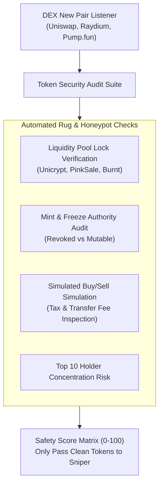

# Jev Token Scanner

A token/project classifier powered by [Jev](https://openrouter.ai) (typesafe/jev-1.13). Scans new and trending tokens from CoinGecko and judges each on project quality, investment potential, honeypot indicators, and rugpull risk.


## 🔍 On-Chain Security & Token Scanner



---

## Setup

```bash
cd ~/Projects/jev-token-scanner
python3 -m venv .venv
source .venv/bin/activate
pip install requests python-dotenv pyyaml

cp .env.example .env
# Edit .env and add your OPENROUTER_API_KEY
```

## Usage

### Scan tokens
```bash
python run.py scan --trending --limit 10           # Trending tokens
python run.py scan --markets --limit 20            # Top market cap
python run.py scan --new --limit 30 --enrich       # New listings with details
```

### Classify a single token
```bash
python run.py classify bitcoin
python run.py classify ethereum
```

### Watch mode (continuous scanning)
```bash
python run.py watch --trending --interval 300
python run.py watch --markets --limit 10 --enrich
```

### View stats
```bash
python run.py stats
```

## Jev Classification

Each token is evaluated on:

| Question | Type | Values |
|----------|------|--------|
| Project quality? | choice | legit-promising, mediocre, suspicious, likely-rug, confirmed-rug |
| Investment score? | score | 1-10 |
| Honeypot indicators? | noul | true/false |
| Likely rugpull? | noul | true/false |

## State fed to Jev

- Name, symbol, market cap, volume, price
- Liquidity score, community/developer scores
- Social metrics (Twitter followers, Telegram users, Reddit subscribers)
- Contract address and platform info
- Supply metrics (circulating, total, max)
- Sentiment votes, ATH/ATL data

## Files

| File | Purpose |
|------|---------|
| `token_scanner.py` | CoinGecko API client (markets, trending, new, enrich) |
| `jev_client.py` | Jev OpenRouter decisions API client |
| `classifier.py` | Feeds token state to Jev, returns classification |
| `logger.py` | JSONL result logger with stats |
| `run.py` | CLI: scan, classify, watch, stats |
| `config.yaml` | Configuration (endpoints, questions, intervals) |
| `.env.example` | Required API keys template |

## Results

Results are logged to `scan_results.jsonl` (JSONL format). Each entry contains:
- Token metadata (name, symbol, market cap, etc.)
- Jev classification (quality, score, honeypot, rugpull)
- Timestamp and scan type